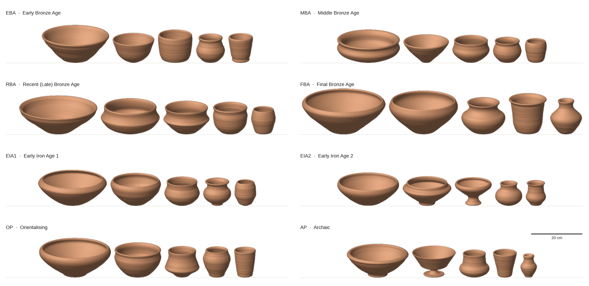
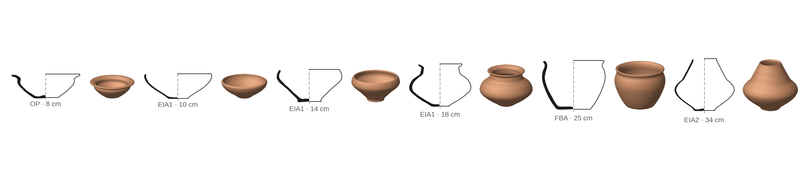
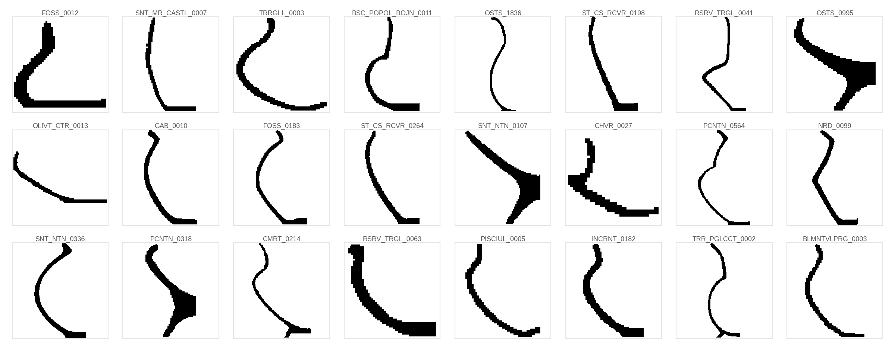
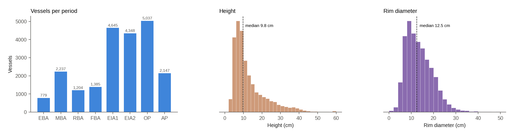
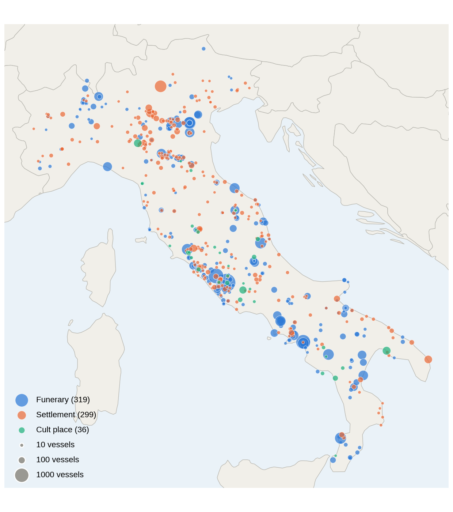

# AIPPD · Ancient Italy Pottery Profiles Dataset

**21,782 whole-vessel profiles from 652 archaeological contexts of continental Italy, from the Early Bronze Age to the
Archaic period (c. 2300–480 BC), ready for machine learning.**

[](https://doi.org/10.4475/0840)



<sub>Five vessels of each period, drawn in 3D by revolving their profile around the axis, all at the same scale.</sub>

AIPPD is a dataset of archaeological pottery **profiles**: the section of a vessel as archaeologists draw it, from rim
to base, on one side of the axis. Each profile was traced from a published drawing, cleaned, filled and standardised,
and is linked to its context, chronology, typological information, metric measures and bibliographic source. To our
knowledge it is the largest dataset of ceramic profiles available.

It is **Appendix A** of the book

> Cardarelli, L. 2024. *Morphological variability and standardisation of vessel shapes in the 2nd and first half of the
> 1st millennium BC in continental Italy. A data science and machine learning project for the quantitative study of
> archaeological ceramic profiles*. Adrias 18. Bari: Edipuglia. ISBN 979-12-5995-084-0.
> [doi:10.4475/0840](https://doi.org/10.4475/0840) (open access)

which is the published version of the author's PhD thesis (University of Bari Aldo Moro, PhD course PASAP_Med,
XXXVI cycle). This repository repackages Appendix A in formats ready for machine learning, with a small loader. The
original appendix and the supplementary website are at
[edipuglia.it/pasap01](https://edipuglia.it/pasap01/index.html).

---

## What a record is


<sub>Each record is a profile drawing (left of the dash-dot axis: the section, filled; right: the outer outline, here
redrawn for display), from which the whole vessel can be rebuilt by rotation (right).</sub>

The profiles were prepared by hand, one by one (book, § 2.2.1):

1. the profile is extracted from the archaeological drawing;
2. **decoration and handles (and other appendages) are removed**;
3. the profile is filled in black;
4. all images are standardised in size and resolution, without distorting the aspect ratio.

In the data each profile is a **binary 256 × 256 image** (True = the vessel's section), scaled to fit the frame with its
proportions kept, the axis of rotation on its **right edge**. The real size of every vessel is given by its measures
(height, maximum width, rim diameter, capacity, outer surface), computed when the dataset was built.


<sub>Twenty-four random profiles, as stored (256 × 256).</sub>

## Coverage



<table>
<tr><td width="52%">



</td><td>

| | |
|---|---|
| Vessels | 21,782 |
| Contexts | 652 (654 located sites) |
| Context type | funerary 17,657 · settlement 3,419 · cult places 706 |
| Periods | EBA 779 · MBA 2,237 · RBA 1,204 · FBA 1,385 · EIA1 4,645 · EIA2 4,348 · OP 5,037 · AP 2,147 |
| Manufacture | handmade 14,703 · wheel-made 3,172 · moulded 57 |
| Ware | impasto 18,548 · argilla depurata 1,499 · bucchero 555 · grigia 18 |
| Height | 1.9–87.9 cm (median 9.8 cm) |
| Source publications | 503 |

</td></tr>
</table>

### Chronology

| Period | | Dates (BC) | Sub-periods (`subperiod`) |
|---|---|---|---|
| EBA | Early Bronze Age | 2300–1700 | EBA1 2300–2000 · EBA2 2000–1700 |
| MBA | Middle Bronze Age | 1700–1350 | MBA1-2 1700–1500 · MBA3 1500–1350 |
| RBA | Recent (Late) Bronze Age | 1350–1200/1150 | RBA1 · RBA2 |
| FBA | Final Bronze Age | 1200/1150–1000/950 | FBA1-2 1200–1050 · FBA3 1050–1000/950 |
| EIA1 | Early Iron Age 1 | 1000/950–820/800 | EIA1A 1000/950–870 · EIA1B 870–825 |
| EIA2 | Early Iron Age 2 | 820/800–725 | EIA2A 825–770 · EIA2B 770–725 |
| OP | Orientalising period | 725–580 | AOP 725–680 · MOP 680–630 · LOP 630–580 |
| AP | Archaic period | 580–480 | |

Absolute dates after Bartoloni 2012, Pacciarelli 2000 and Peroni 1994, as summarised in the book (§ 2.2.1).

## Files

| File | Size | Content |
|---|---|---|
| `data/aippd_profiles_256.npz` | 5 MB | `masks`: (21782, 256, 32) uint8, bit-packed profiles; `ids`: (21782,) |
| `data/aippd.parquet` | 9 MB | everything in one table: metadata, measures and each profile as a 1-bit PNG (`mask_png`) |
| `data/aippd_metadata.csv` | 4 MB | metadata and measures, one row per vessel, same order as the masks |
| `data/aippd_bibliography.csv` | 0.1 MB | the 503 source publications (`bibliography_id`, short and full reference, number of vessels) |
| `data/aippd_sites.geojson` | 0.1 MB | the contexts as points (WGS84), with `context_id` and number of vessels |
| `data/gis/sites.*` | 0.2 MB | the original shapefile of the contexts (WGS 84 / UTM 33N) |
| `aippd.py` | | a minimal loader (numpy and pandas) |
| `appendix_a/aippa/` | | AIPPA, the analysis library of the book, as published in Appendix A (now developed as [PyPottery](https://github.com/lrncrd/PyPottery)) |
| `scripts/` | | how the files above and the figures of this page were made |

The bit-packed masks take 5 MB instead of the 156 MB of the original sparse matrix; the conversion is lossless (checked
on every profile).

### Fields of `aippd_metadata.csv`

| Field | Description |
|---|---|
| `id` | record identifier: context abbreviation and sequential number (e.g. `PDG_0001`, Pianello di Genga no. 1) |
| `context`, `context_id` | site or context as known in the literature, and its numeric identifier (links to the sites file) |
| `context_type` | `Funerary` (grave or cemetery), `Settlement` (residential or productive), `Cultual` (shrine, cave or other cult place) |
| `region`, `facies` | cultural region and archaeological facies, where given |
| `period`, `subperiod` | wide chronology (always given) and close chronology (when the record can be dated more precisely) |
| `chronology_id` | identifier of the chronological phase of the context |
| `morphology` | `Open shape`, `Closed shape`, `Others` |
| `form` | morphological-functional interpretation, mostly as given by the publication (Tazza/Ciotola, Scodella, Olla, Brocca/Orciolo, Vaso a collo/Biconico, Anfora, Coppa, Boccale, Coperchio/Teglia, Sostegno, Kothon, Cratere) |
| `functional_class` | Class 1–4 and Others, from shape and the handles or other handling elements of the original drawing (book, § 2.2.1) |
| `manufacturing_technique` | Handmade, Wheelmade, Moulded |
| `material` | ware: Impasto, Argilla depurata, Grigia, Bucchero |
| `funerary_function` | in funerary contexts: Urn, Cover (of the urn), Grave good |
| `grave` | grave as given in the publication |
| `bibliography_id`, `page`, `figure_or_plate`, `item_number` | where the drawing is published (see `aippd_bibliography.csv`) |
| `note` | `RandomForest Attr.` for the 117 records whose period was assigned by a classifier (book, § 2.4) |
| `height_cm`, `max_width_cm`, `rim_diameter_cm` | height, maximum width (from the axis to the outer profile, doubled) and inner rim diameter |
| `capacity_l`, `outer_surface_m2` | capacity (stacked cylinders on the inner profile) and outer surface |

## Quick start

```python
import aippd

masks, ids = aippd.load_masks()     # (21782, 256, 256) bool
meta = aippd.load_metadata()        # same order as masks

# e.g. all Final Bronze Age bowls from funerary contexts
sel = (meta.period == "FBA") & (meta.form == "Scodella") & (meta.context_type == "Funerary")
bowls = masks[sel.values]

# a profile at its real size (1 px = 1 mm)
pot = aippd.real_size(masks[0], meta.height_cm[0])
```

With the parquet file only (pandas, pyarrow, pillow), e.g. from a notebook:

```python
import io, numpy as np, pandas as pd
from PIL import Image

df = pd.read_parquet("data/aippd.parquet")
df["mask"] = [np.array(Image.open(io.BytesIO(b))) > 0 for b in df.pop("mask_png")]
```

A PyTorch dataset in a few lines:

```python
import torch, aippd

class AIPPD(torch.utils.data.Dataset):
    def __init__(self):
        self.masks, _ = aippd.load_masks()
        self.meta = aippd.load_metadata()
    def __len__(self):
        return len(self.masks)
    def __getitem__(self, i):
        x = torch.from_numpy(self.masks[i]).float()[None]          # (1, 256, 256)
        return x, self.meta.period[i]
```

## Things to know before using it

- **Body only.** Handles, lugs, spouts and decoration were removed from the profiles. The `form` and `functional_class`
  fields, however, were assigned on the original drawings and also rest on them: they are not fully recoverable from
  the profiles.
- **Scale.** Each profile fills the 256 × 256 frame with its proportions kept; absolute size is in the measures, not in
  the image. Use `aippd.real_size` to bring a profile to its real size.
- **Measures** assume a vessel perfectly symmetrical about its axis; capacity and surface are the most sensitive to
  this, especially for handmade pottery.
- **Chronology.** 117 records were dated by a classifier from neighbouring records (`note`). Before the Orientalising
  period, records without information were recorded as handmade impasto; from the Orientalising period on, technique
  and ware are left empty when not given by the publication.
- **Sites** are located from published coordinates when available, otherwise near the toponym of the find-spot.
- **Sampling.** Only whole or reasonably reconstructible vessels were recorded, so funerary contexts dominate. The
  dataset reflects what has been published and drawn, not the original assemblages.
- **Version 0.1.** Corrections and new contexts are welcome (open an issue).

## How to cite

Please cite the book, of which the dataset is Appendix A:

```bibtex
@book{cardarelli2024morphological,
  author    = {Cardarelli, Lorenzo},
  title     = {Morphological variability and standardisation of vessel shapes in the 2nd and first half of the 1st
               millennium {BC} in continental {Italy}. {A} data science and machine learning project for the
               quantitative study of archaeological ceramic profiles},
  series    = {Adrias},
  number    = {18},
  publisher = {Edipuglia},
  address   = {Bari},
  year      = {2024},
  isbn      = {979-12-5995-084-0},
  doi       = {10.4475/0840}
}
```

and, if you use the files of this repository, the repository itself (see `CITATION.cff`).

## Related work by the author

- Cardarelli, L. 2022. A deep variational convolutional autoencoder for unsupervised features extraction of ceramic
  profiles. A case study from central Italy. *Journal of Archaeological Science* 144: 105640.
  [doi:10.1016/j.jas.2022.105640](https://doi.org/10.1016/j.jas.2022.105640)
- Cardarelli, L. 2023. Traditional and digital typologies compared: the example of Italian protohistory. *Origini*
  XLVII: 161–182.
- Cardarelli, L. 2024. From fragments to digital wholeness: an AI generative approach to reconstructing archaeological
  vessels. *Journal of Cultural Heritage* 70: 250–258.
  [doi:10.1016/j.culher.2024.09.012](https://doi.org/10.1016/j.culher.2024.09.012)
- [PyPottery](https://github.com/lrncrd/PyPottery): tools for digitising and analysing archaeological pottery drawings.

## Licence

The code (`aippd.py`, `scripts/`, `appendix_a/aippa/`) is released under the Apache License 2.0 (`LICENSE`).
**[TO CONFIRM: licence of the data, e.g. CC BY 4.0.]** The drawings the profiles were traced from remain the work of
their authors and publishers; see `data/aippd_bibliography.csv` for the sources.

## Acknowledgements

The dataset was built during the author's PhD at the University of Bari Aldo Moro (PASAP_Med, XXXVI cycle), tutor
Prof. Marco Bettelli, co-tutors Prof. Andrea Cardarelli and Prof. Paola Moscati. The 3D renderings on this page were
made with the renderer of the [Reconstructor](https://github.com/lrncrd/Reconstructor) project; the map uses
[Natural Earth](https://www.naturalearthdata.com/) boundaries.
